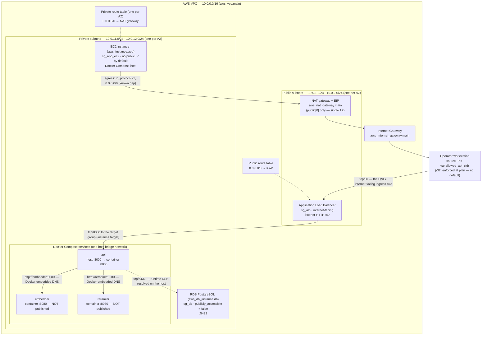
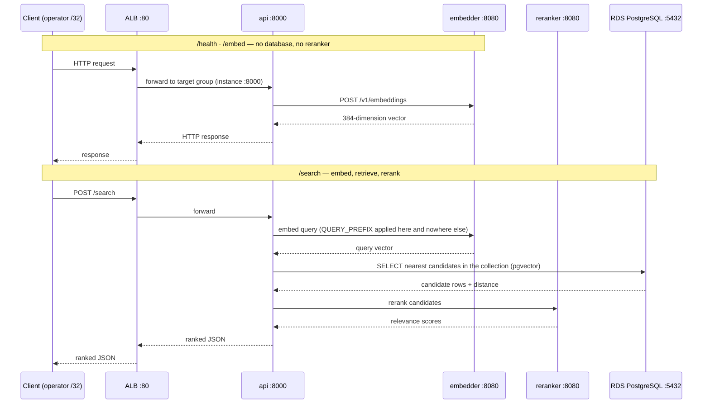

# Architecture — the deployed lemondrop stack

This document describes the **network and request topology that the Terraform
actually declares**, not an intended one. Every node, edge, port and rule below
is grounded in a file and line in this repository. Where the configuration does
not determine a value, that is stated rather than filled in.

It covers the **AWS deployment** (`infra/*.tf` + `docker-compose.yml` as the host
runs it). The local development stack has a different database story — the
`postgres` service behind the `devdb` profile — and that is described in
`README.md` under [Two database deployments](../README.md#two-database-deployments).

> **A note on `infra/README.md`, so this file is not read against it.** That
> file's header and scope table still say EC2, the ALB and RDS are "not in this
> directory" and that the configuration "has never been validated". That is
> stale: `infra/compute.tf`, `infra/database.tf`, `infra/load_balancer.tf` and
> `infra/iam.tf` all exist and the same file's closing section says the stack is
> deployed. The contradiction is recorded as finding **F-1** in
> `docs/second-engineer-acceptance.md` §10. **It is not repaired here** — this
> document grounds itself in the `.tf` files directly, which are the authority.

---

## 1. Network topology

**Read the diagram for what is *absent* as much as what is present.** Mermaid
draws an edge only where the configuration builds a path. There is **no edge**
from the ALB (or the internet) to `embedder`, to `reranker`, or to RDS, because
no resource, rule, route or target in this stack creates one. A missing edge is
the strongest form of the guarantee — see §5.

### 1.1 What the diagram does *not* determine

Terraform does not fix these at authoring time; they are resolved at `plan` or
`apply` and are **not** values you can read out of this file:

| Value | Why the config does not fix it |
|---|---|
| The **AZ letters** used | Derived from `data.aws_availability_zones.available` and sliced to the subnet-count (`infra/main.tf:41`). Not hardcoded, deliberately. |
| The **operator `/32`** in the ingress rule | `var.allowed_api_cidr` has **no default** and is validated to be a `/32` (`infra/variables.tf:111`). The deployed value is not recorded in this repository. |
| The **NAT gateway's Elastic IP** | Allocated at apply (`infra/main.tf:233-252`). |
| The **RDS endpoint hostname** | Assigned at apply; read back with `describe-db-instances` (`infra/outputs.tf:209-224`). |
| The **EC2 instance id** and **ALB DNS name** | Assigned at apply; the routes to discover both are `docs/deployment.md` §7.1.1 step 1 and §5.3. |
| The **AMI id** | Resolved from the AWS public SSM parameter at plan time (`infra/compute.tf:105-107`). |

Everything else in the diagram — CIDRs, ports, security groups, the route
tables, the target group — is a literal in the configuration at the line
references given.

---

## 2. Ports — every port the config names

Read from `infra/locals.tf`, `infra/security_groups.tf`, `infra/load_balancer.tf`,
`infra/database.tf`, `docker-compose.yml` and `.env.example`.

| Hop | Port | Protocol | Source of the value |
|---|---|---|---|
| Operator → ALB | **80** | HTTP | `local.lb_port = 80` (`infra/locals.tf:29`); listener `infra/load_balancer.tf:313-317` |
| ALB → `api` (target group) | **8000** | HTTP | `local.app_port = 8000` (`infra/locals.tf:18`); target group `infra/load_balancer.tf:233`; attachment `:299-310` |
| `api` host publish | **8000** | HTTP | `API_HOST_PORT=8000` (`.env.example:15`) → `docker-compose.yml:441-442` |
| `api` container listen | **8000** | HTTP | `API_INTERNAL_PORT=8000` (`.env.example:21`); uvicorn binds it |
| `embedder` container | **8080** | HTTP | `EMBEDDER_INTERNAL_PORT=8080` (`.env.example:25`) — **container-internal, never published** |
| `reranker` container | **8080** | HTTP | `RERANKER_INTERNAL_PORT=8080` (`.env.example:34`) — **container-internal, never published** |
| `api` → RDS | **5432** | TCP | `local.db_port = 5432` (`infra/locals.tf:23`); RDS `port = local.db_port` (`infra/database.tf:134`) |
| Dev `postgres` (local only) | **127.0.0.1:5432** | TCP | `docker-compose.yml:712-713` — bound to loopback, `devdb` profile only; **not part of the AWS stack** |

**There is no other port.** In particular:

- There is **no port 22** (SSH) in any security group. `create_ssh_key` defaults
  to `false` and creating a key opens nothing (`infra/compute.tf:111-152`).
- There is **no port 443** and no TLS. The listener is port 80 cleartext
  (`infra/load_balancer.tf:10-35`, `infra/security_groups.tf:125-149`).
- The **Docker socket** is a Unix-domain socket on the host, not a TCP port, and
  it is not published. Nothing in this stack exposes it over the network.
- **8080 appears nowhere as a rule, target or published port** — only in prose
  explaining its absence (`infra/security_groups.tf:46-108`).

---

## 3. Security-group matrix

Every row is a single explicit rule resource, with its line. The security groups
carry **no inline rules** (`infra/security_groups.tf:19-40`), which is why
`sg_db` ends up deny-by-default in the direction it does not open.

| Security group | Direction | Protocol / port | Allowed source or destination | Line |
|---|---|---|---|---|
| `sg_alb` | Ingress | tcp **80** | `var.allowed_api_cidr` — the operator's `/32` only | `infra/security_groups.tf:150-158` |
| `sg_alb` | Egress | tcp **8000** | `sg_app_ec2` only — the ALB cannot reach the database or the internet | `infra/security_groups.tf:163-171` |
| `sg_app_ec2` | Ingress | tcp **8000** | `sg_alb` only — no `0.0.0.0/0` | `infra/security_groups.tf:192-200` |
| `sg_app_ec2` | Egress | **all** (`-1`) | `0.0.0.0/0` — unrestricted. **Known gap**, see §6 | `infra/security_groups.tf:301-307` |
| `sg_db` | Ingress | tcp **5432** | `sg_app_ec2` only — the sole inbound path to the database | `infra/security_groups.tf:355-363` |
| `sg_db` | Egress | — | **none declared** — the group has no egress at all | `infra/security_groups.tf:312-332`, `:365-366` |

The `publicly_accessible = false` flag on the RDS instance
(`infra/database.tf:196`) is a **second, independent** control on the same
property as the `sg_db` ingress rule. The config says so at
`infra/database.tf:175-196` and `infra/security_groups.tf:334-354`: the two are
attributes of different things (the instance vs. the network) and fail
independently. `0.0.0.0/0` on 5432 appears nowhere in the stack.

---

## 4. Request flow

Route-level details — which handler composes which worker, the funnel sizes, the
empty-collection 200, and the 502/503/504 semantics — are in `README.md` under
[API routes](../README.md#api-routes). The cloud behaviour is recorded in
`docs/verification-milestone-3.md`.

**A request does not touch every component on every route.** `/embed` and
`/health` never reach PostgreSQL and never call the reranker. **`POST /documents`
is a third path**: it embeds through the embedder and *writes* to the store, but
never calls the reranker. `/search` is the only route that applies `QUERY_PREFIX`
and the only one that reads the store before reranking. The sequence diagram
above separates the embed-only path from the full retrieve-and-rerank path on
purpose.

---

## 5. What is NOT reachable from the internet

Each item below states the mechanism that makes it unreachable — not merely the
absence of a rule, but the configuration that has to change to open it.

| Component | Why it is not reachable | Config that enforces it |
|---|---|---|
| **RDS PostgreSQL (5432)** | Not in a public subnet; `publicly_accessible = false`; and its security group has exactly one ingress rule, from `sg_app_ec2`. | `infra/database.tf:172-196`; `infra/security_groups.tf:355-363` |
| **Model ports (8080, `embedder` + `reranker`)** | The containers publish **no host port**; there is no security-group rule for 8080; there is no ALB target group or listener rule pointing at them. `docker-compose.yml` contains exactly one `ports:` key on the API. | `docker-compose.yml:24-47`, `:91-160` (no `ports:`), `:441-442` (the only one); `infra/security_groups.tf:46-108`; `infra/load_balancer.tf:225-232` |
| **Docker socket** | A Unix-domain socket on the host; never published and never declared as a port. | `docker-compose.yml` (no socket mount in the AWS-relevant services) |
| **SSH (22)** | No security group opens port 22; `create_ssh_key = false` by default and creating a key opens nothing. Access is via SSM Session Manager. | `infra/compute.tf:109-152`; `infra/security_groups.tf` (no 22 rule) |

**The inference services are unreachable *by construction*, not by a deny rule.**
`infra/security_groups.tf:46-108` argues this at length and it is the load-bearing
point: building no path is strictly stronger than writing a rule that forbids
one, because a deny rule can be deleted or widened invisibly while a missing path
can only be reopened by *adding* new, reviewable resources. The mechanism is that
all three services share one host bridge network, only `api` is published, so the
workers' 8080 exists only inside the instance's own network namespace.

---

## 6. Egress — stated honestly, not overstated

**`sg_app_ec2` has unrestricted egress** (`ip_protocol = "-1"`, `0.0.0.0/0`,
`infra/security_groups.tf:301-307`). This is a real, documented gap and it is
**not** closed by anything in this stack. It exists because the host must pull
container images, install packages and download ~340MB of GGUF model weights —
without which `/embed` and `/rerank` cannot work at all.

The gap is structural and cannot be fixed in a security group:
`infra/security_groups.tf:216-250` and the "honest gap" section of
`infra/README.md` both state it — a security group attaches to an ENI, and all
three containers share the host's one ENI, so Terraform cannot restrict egress
**per container**. True per-container
egress filtering would need host-level tooling (Docker's `DOCKER-USER` iptables
chain, `docker network disconnect`, per-container egress proxies), which this
config does not provide.

What *is* true, and what the milestone actually requires: no security group and
no route grants the inference containers an **inbound** path, so "the inference
services cannot be reached directly from the internet" holds structurally. An
outbound connection an inference container initiates dies at an RFC1918 address
inside the instance's own namespace.

**One more honest note on routing.** `enable_nat_gateway` defaults to `true`
(`infra/variables.tf:171-174`), so the private subnets' `0.0.0.0/0` route points
at the NAT gateway. With it set to `false`, that route points at the **internet
gateway** instead (`infra/main.tf:316-353`), which *removes egress isolation from
the private subnets* — a deliberate cost trade, not an oversight. It is mitigated
only because `app_associate_public_ip` also defaults to `false`, so the instance
holds no public IP and that route provides no path out unless the operator also
sets `app_associate_public_ip=true` (`infra/variables.tf:537-561`). **Do not
describe this stack's private tier as egress-isolated without checking both
variables.**

---

## 7. Service dependencies, and why

Within the EC2 host, `api` declares `depends_on` on **both** workers with
`condition: service_healthy` (`docker-compose.yml:601-609`):

| Dependency | Condition | Why |
|---|---|---|
| `api` → `embedder` | `service_healthy` | `llama.cpp` answers `/health` with 503 while it reads the GGUF off disk and loads it into memory. Plain `depends_on` waits only for a container to be *started*, so the API would come up against an unready worker. `service_healthy` waits for the healthcheck to pass. |
| `api` → `reranker` | `service_healthy` | Same reason, same mechanism. |

There is deliberately **no `depends_on` between `embedder` and `reranker`** —
they are independent and neither calls the other, so ordering them would encode a
false fact (`docker-compose.yml:59-62`). There is deliberately **no `depends_on`
on `postgres`** — that service is profile-gated and does not exist on the EC2
host, where a bare `docker compose up -d` runs; declaring the dependency would
fail every compose call on a database the host is not running
(`docker-compose.yml:538-551`, `:601-609`).

At the AWS layer, the dependency chain Terraform itself enforces is: the ALB
target group can only attach the instance once it exists (`aws_instance.app` is
ungated, `infra/compute.tf:16-31`), and the RDS instance depends on its subnet
group (`infra/database.tf:302-307`), which in turn requires at least two private
subnets (`infra/database.tf:84-89`).

---

## 8. Where each fact lives

| Fact | Source of truth |
|---|---|
| Network, subnets, routes, NAT | `infra/main.tf` |
| Security groups and every rule | `infra/security_groups.tf` |
| ALB, listener, target group, health check | `infra/load_balancer.tf` |
| EC2, AMI resolution, IMDS, boot script | `infra/compute.tf` |
| RDS instance, subnet group, storage, lifecycle | `infra/database.tf` |
| Ports and name prefix | `infra/locals.tf` |
| Variable defaults (toggles, protection flags, storage) | `infra/variables.tf` |
| Compose services, ports, healthchecks, dependencies | `docker-compose.yml` |
| Port and alias defaults | `.env.example` |
| Cost of each resource | `COSTS.md` |
| Operate / verify / tear down | `RUNBOOK.md`, `docs/deployment.md` |
| Provenance of the deployed artifact | `docs/verification-milestone-4.md` |
